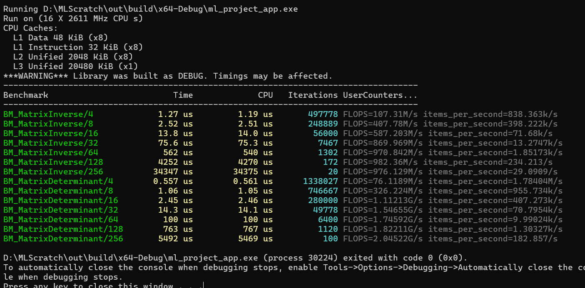

# MLScratch

Building a machine learning library from scratch in C++. Right now, the focus is on getting the foundational math right before moving on to building actual models on top of it. 

I've put together a custom matrix engine to handle core linear algebra operations like matrix inversion and determinants. It's written in C++20, manages memory safely with the Rule of Five, and uses Google Benchmark to keep track of how the algorithms scale as the matrices get larger.

Here is a snapshot of the current performance scaling for inversions and determinants:



## Building and Running

The project uses standard CMake. To compile and run the benchmarks yourself, it's best to build in Release mode so the compiler optimizations kick in:

```bash
cmake -B build -DCMAKE_BUILD_TYPE=Release
cmake --build build --config Release

# Run the benchmarks
./build/Release/ml_benchmark
```