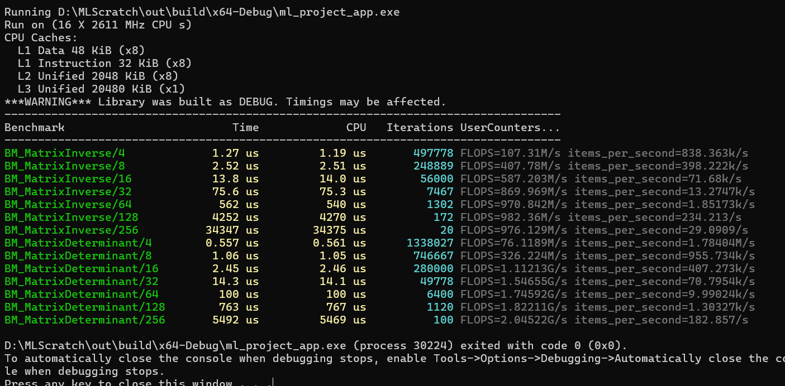

# MLScratch

Building a machine learning library from scratch in C++. Right now, the focus is on getting the foundational math and data pipeline right before moving on to building actual models on top of it. 

I've put together a custom matrix engine to handle core linear algebra operations like matrix inversion and determinants. It's written in C++20, manages memory safely with the Rule of Five, and uses Google Benchmark to keep track of how the algorithms scale as the matrices get larger.

Here is a snapshot of the current performance scaling for inversions and determinants:



## Implemented Components

### 1. Linear Algebra Core (`utils/matrix.hpp`, `utils/matrix.cpp`)
* **Cache-Blocked Matrix Multiplication (`operator*`, `operator*=`)**: L1-tiled $i$-$k$-$j$ GEMM kernel with `RESTRICT` pointer aliasing hints and vectorization pragmas (`PRAGMA_IVDEP`).
* **Matrix Decompositions & Ops**: LU-based matrix inversion (`Inverse`), cache-friendly transpose, row/column reductions (`mean`), and row-wise broadcasting (`add_broadcast`).

### 2. Data Pipeline & Preprocessing (`utils/loader.hpp`, `utils/preprocessor.hpp`)
* **CSV Ingestion & Splitting**: Loads numeric CSV datasets directly into `utils::Matrix` and splits feature/target matrices (`split_xy`, `train_test_split`).
* **Standardization**: Z-score feature scaling (`StandardScaler`).

### 3. Model Interfaces & Classical Models (`models/base.hpp`, `models/linear_regression.hpp`)
* **Compile-Time Concepts (`models/base.hpp`)**: Enforces uniform `fit` and `const`-correct `predict` interfaces via C++20 `SupervisedModel` and `UnsupervisedModel` concepts.
* **Linear Regression (`models/linear_regression.hpp`)**:
  * **Implemented**: Closed-form Ordinary Least Squares (OLS) solver via mean-centered Normal Equations:

$$W = (X_c^T X_c)^{-1} X_c^T y_c, \quad b = \bar{y} - \bar{X} W$$

  * **Planned / In Progress**: Batch & Mini-Batch Gradient Descent solvers, learning rate scheduling, and $L_2$ (Ridge) regularization.

## Building and Running

The project uses standard CMake. To compile and run the benchmarks yourself, it's best to build in Release mode so the compiler optimizations kick in:

```bash
cmake -B build -DCMAKE_BUILD_TYPE=Release
cmake --build build --config Release

# Run the benchmarks
./build/Release/ml_benchmark